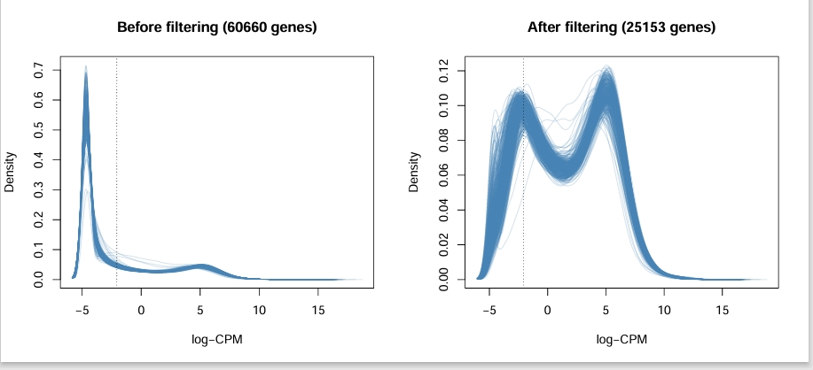
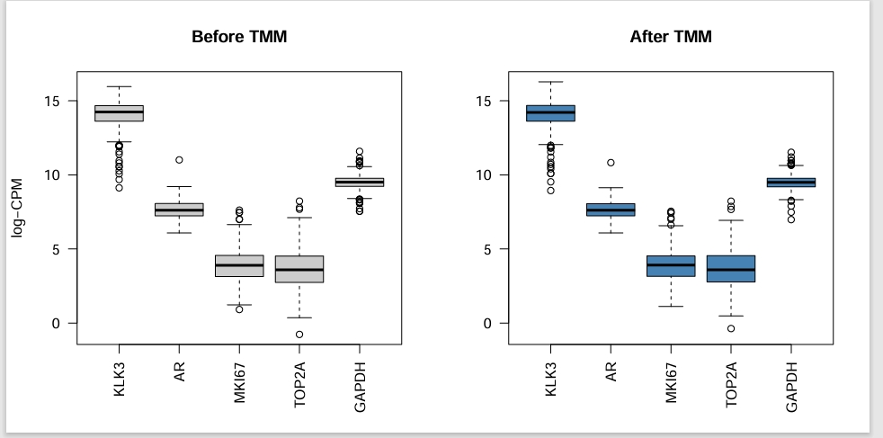
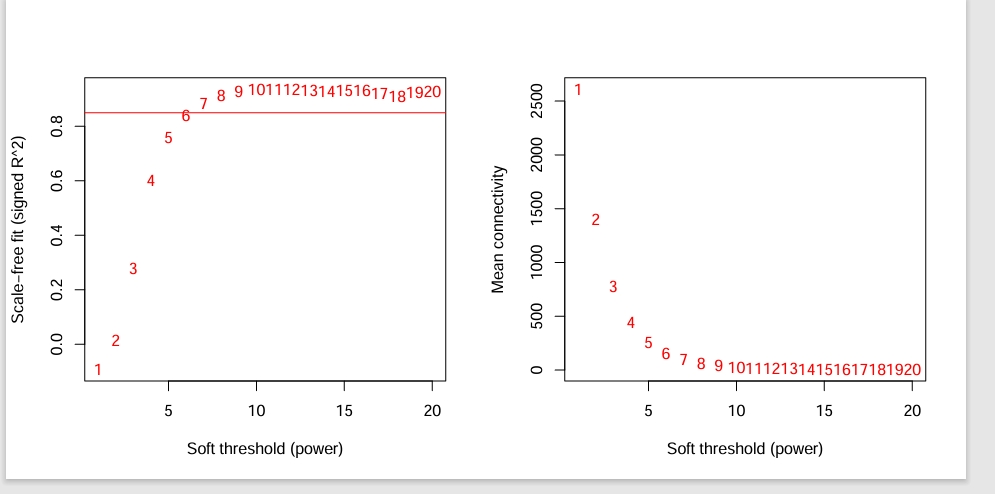
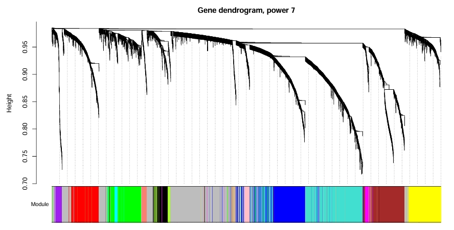
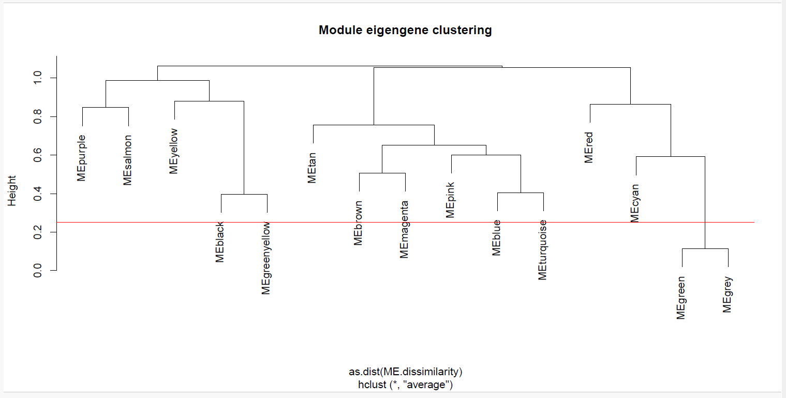
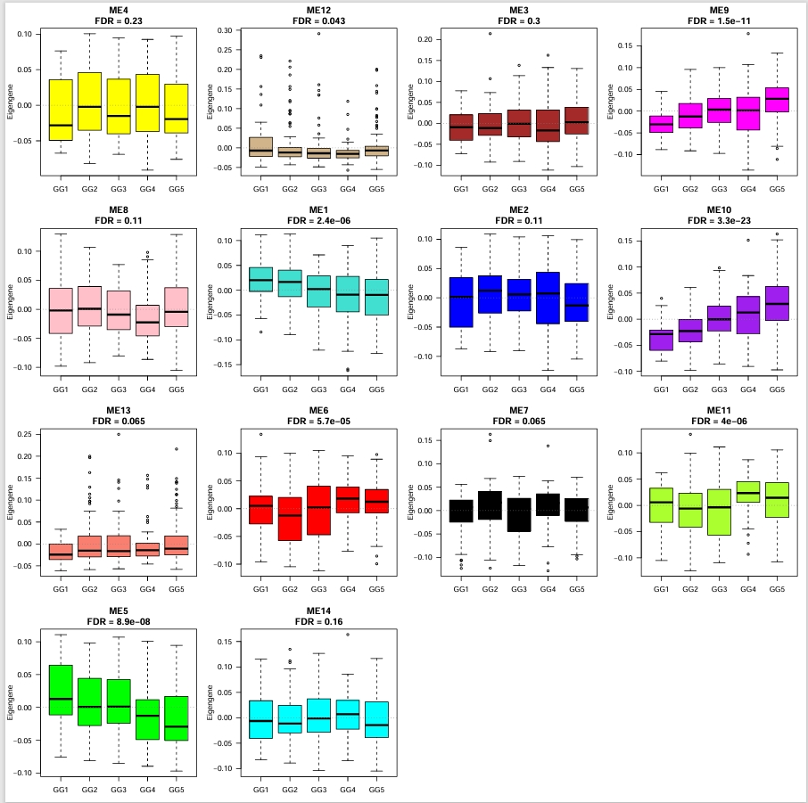

# WGCNA of TCGA-PRAD tumours by Gleason grade group

- TCGA-PRAD, fetched with TCGAbiolinks (GDC, `STAR - Counts`), saved as `prad_se.rds` (SummarizedExperiment).
- I used the primary tumours only (barcode sample type `-01`) and one tumour per patient (`!duplicated(substr(colnames(se), 1, 12))`).
**Grade groups:** were derived from `primary_gleason_grade` and `secondary_gleason_grade` using a formula I found online. Table of data below: 

| Group | Rule | n |
|---|---|---|
| GG1 | sum ≤ 6 | 44 |
| GG2 | 3+4 | 138 |
| GG3 | 4+3 | 96 |
| GG4 | sum = 8 | 59 |
| GG5 | sum ≥ 9 | 131 |

29 tumours with missing Gleason patterns were dropped, leaving 468 samples. 

## Methods

### 1. Filtering and normalisation (edgeR)

- Filtering and normalisation was done using edgeR mostly following the tutorial here - https://bioconductor.org/packages/release/workflows/vignettes/RNAseq123/inst/doc/limmaWorkflow.html
- Genes after filtering: **25153**.





### 2. Gene selection for the network

The 5,000 most variable genes (median absolute deviation across samples) were taken from `lcpm`, giving `dat`, a 468 × 5000 matrix with samples in rows and genes in columns, as WGCNA expects. 

### 3. Soft-threshold power

Used a signed network  (`networkType = "signed"`). `pickSoftThreshold` scanned powers 1–20, and the signed scale-free fit R² was compared with a 0.85 threshold.



- R² first clears 0.85 at **power 7** and flatterns off at about 0.9–0.93.
- Mean connectivity falls from about 2,600 at power 1 to under 100 by power 7.
- **Used power: 7.**

### 4. Modules

```r
net <- blockwiseModules(dat, power = 7, networkType = "signed", TOMType = "signed",
                        minModuleSize = 30, mergeCutHeight = 0.35, 
                        numericLabels = TRUE, maxBlockSize = 6000, ...)
```

- 5,000 genes fit in one block, so there are no block-boundary effects.
- **14 modules** plus the unassigned (grey, label 0) group, about **24% of genes**.
- Numeric labels map to colours with `labels2colors` (1 turquoise, 2 blue, 3 brown, 4 yellow, 5 green, …).



The dendrogram is clean for several modules but speckled in the middle region, where blue, turquoise, green and purple interleave. Turning off the PAM stage made little difference, so this is a tree-cutting issue rather than a power issue.



- No two real modules are more than r ≈ 0.65 correlated after merging at 0.35.
- The closest pairs (black/greenyellow, blue/turquoise) are about r ≈ 0.6, and are kept separate.
- The grey eigengene correlates with green (r ≈ 0.89). Checking whether grey genes were hidden green members showed that only **16 grey genes** would move at kME > 0.5, spread over five modules. Grey is left as is.
- The grey eigengene (`ME0`) is excluded from all downstream tests.

### 5. TODO Modules vs grade group

Her are some prelim stats but I need to check this in more detail. 



| Module | FDR | Pattern |
|---|---|---|
| ME10 | 3.5e-23 | rises steadily GG1 → GG5 |
| ME9 | 1.6e-11 | rises steadily GG1 → GG5 |
| ME5 | 9.6e-8 | falls with grade |
| ME1 | 2e-6 | falls with grade |
| ME11 | 3.6e-6 | non-monotonic, small effect |
| ME6 | 5.2e-5 | non-monotonic, small effect |