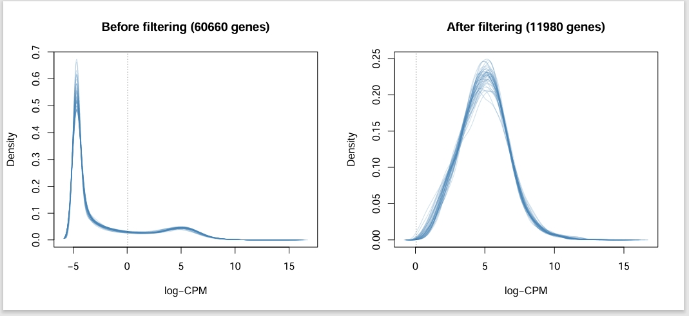
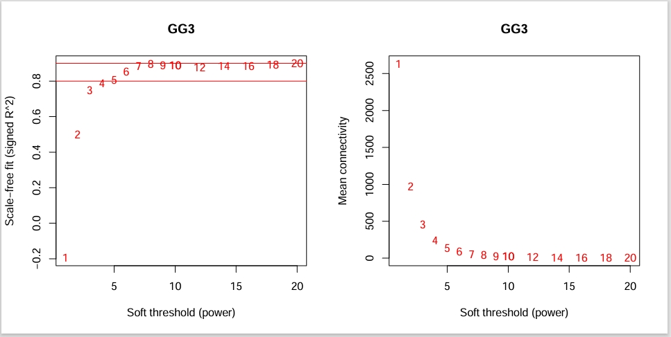
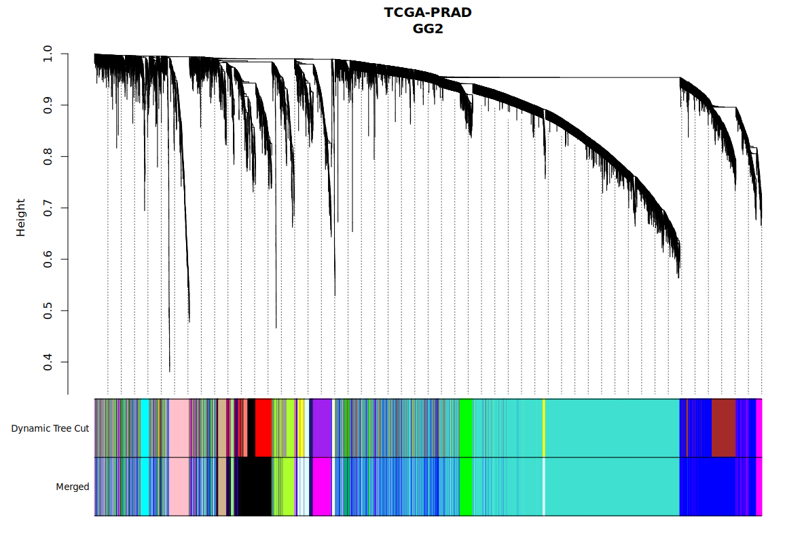

# WGCNA of TCGA-PRAD tumours by Gleason grade group

- TCGA-PRAD, fetched with TCGAbiolinks (GDC, `STAR - Counts`), saved as `prad_se.rds` (SummarizedExperiment).
- I used the primary tumours only (barcode sample type `-01`) and one tumour per patient (`!duplicated(substr(colnames(se), 1, 12))`).
**Grade groups:** were derived from `primary_gleason_grade` and `secondary_gleason_grade` using a formula I found online. Table of data below: 

| Group | Rule | n |
|---|---|---|
| GG1 | sum ≤ 6 | 44 |
| GG2 | 3+4 | 138 |
| GG3 | 4+3 | 96 |
| GG4 | sum = 8 | 59 |
| GG5 | sum ≥ 9 | 131 |

29 tumours with missing Gleason patterns were dropped, leaving 468 samples. 

## Methods

### 1. Filtering and normalisation (edgeR)

- Filtering and normalisation was done per group via a >= 1 CPM cut, normalisation was done using edgeR
- ~10-11k genes per GG after filtering 
- Example plot of density for GG1 below 

### 2. Gene selection for the network

- We use the full set of genes in each grade (i.e, 10k genes). 

### 3. Soft-threshold power

- Used a signed network  (`networkType = "unsigned"`). `pickSoftThreshold` scanned powers 1–20, and the signed scale-free fit R² was compared with a 0.85 threshold.
- Was mostly fine to use the powers that Mik used in the thesis, example threshold plot below (GG3), full plots for each network are in the figures folder. 

### 4. Modules

-Constructed Modules using WGCNA and the powers determined from the soft-threshold. Set minimum number modules (before merging ) to be 30, which ensures 20-30 modules per Gleason grade. 
- Example dendrogram and genetree shown below: 

-Networks, TOMs, modules, genes, modulecolours, etc. are all saved in the network folder (although this probably won't be on github because of storage limits)

| Group  | Samples | Genes kept | % of 60,660 | Paper: genes | Modules | Paper: modules |
|--------|--------:|-----------:|------------:|-------------:|--------:|---------------:|
| Normal | 52      | 12,006     | 19.8%       | 11,679       | 40      | 37             |
| GG1    | 44      | 11,980     | 19.7%       | 11,557       | 21      | 23             |
| GG2    | 138     | 11,295     | 18.6%       | 11,099       | 14      | 13             |
| GG3    | 96      | 11,146     | 18.4%       | 10,800       | 21      | 19             |
| GG4    | 59      | 10,919     | 18.0%       | 10,695       | 19      | 29             |
| GG5    | 131     | 11,000     | 18.1%       | 10,360       | 30      | 31             |

### 5. Calculating Gene age and determining module cellulairty 

- Used the phylostrata dat to classify each gene as either UC or MC
- Had to do a mapping between ENSG to geneID (used ensembleDB)
- There were a few NA genes that couldn't be matched but a search of these showed that they were non-coding
- To determine if modules were UC or MC I used a fisher exact test, then used a BH correction and set the threshold at p < 0.05 
- Need to check that the modules and their UC/MC classification are mapping to genes that we'd expect based on age
- Don't end up with the same number of UC/MC/Mixed as Mik did. Table below:

| Group |  UC | Mixed | MC
|---|---|---| ---|
| Normal | 17 | 16 | 7 
| GG1 |4 | 6  | 11
| GG2 | 2 | 6 | 6 
| GG3 | 6 | 9 | 6 
| GG4 | 2| 9| 8 
| GG5 | 8 |13 | 9 |

Stats for UC vs MC for each module and per grade: 

 ### Normal

| Module          | FDR (UC) | FDR (MC) | Class |
|-----------------|---------:|---------:|-------|
| plum1           | 1        | 7.75e-03 | MC    |
| darkred         | 0.0365   | 1        | UC    |
| lightsteelblue1 | 0.263    | 1        | Mixed |
| lightgreen      | 1        | 1.01e-14 | MC    |
| plum2           | 0.0197   | 1        | UC    |
| cyan            | 0.348    | 1        | Mixed |
| purple          | 1        | 0.832    | Mixed |
| paleturquoise   | 7.46e-03 | 1        | UC    |
| mediumpurple3   | 1        | 1.21e-05 | MC    |
| lightpink4      | 0.0197   | 1        | UC    |
| green           | 4.30e-04 | 1        | UC    |
| black           | 4.30e-04 | 1        | UC    |
| darkorange2     | 0.0398   | 1        | UC    |
| greenyellow     | 1        | 5.15e-10 | MC    |
| blue            | 1        | 1.34e-21 | MC    |
| darkolivegreen  | 0.345    | 1        | Mixed |
| maroon          | 0.0912   | 1        | Mixed |
| lightcyan       | 1.41e-13 | 1        | UC    |
| thistle2        | 0.0130   | 1        | UC    |
| skyblue         | 1        | 1.02e-06 | MC    |
| lavenderblush3  | 4.30e-04 | 1        | UC    |
| darkorange      | 0.0130   | 1        | UC    |
| floralwhite     | 0.795    | 1        | Mixed |
| coral1          | 2.77e-03 | 1        | UC    |
| bisque4         | 0.336    | 1        | Mixed |
| navajowhite2    | 0.819    | 1        | Mixed |
| darkgrey        | 4.30e-04 | 1        | UC    |
| orangered4      | 0.864    | 1        | Mixed |
| darkslateblue   | 6.99e-04 | 1        | UC    |
| darkturquoise   | 1        | 0.361    | Mixed |
| orange          | 3.41e-03 | 1        | UC    |
| lightyellow     | 0.265    | 1        | Mixed |
| brown4          | 1.71e-04 | 1        | UC    |
| steelblue       | 0.0285   | 1        | UC    |
| saddlebrown     | 0.196    | 1        | Mixed |
| antiquewhite4   | 0.514    | 1        | Mixed |
| coral2          | 1        | 5.30e-08 | MC    |
| honeydew1       | 0.666    | 1        | Mixed |
| ivory           | 0.0912   | 1        | Mixed |
| skyblue1        | 0.795    | 1        | Mixed |

### GG1

| Module        | FDR (UC) | FDR (MC) | Class |
|---------------|---------:|---------:|-------|
| darkolivegreen | 1        | 2.53e-12 | MC    |
| blue          | 1.60e-05 | 1        | UC    |
| orange        | 1        | 1.35e-10 | MC    |
| pink          | 0.581    | 1        | Mixed |
| skyblue       | 1        | 0.641    | Mixed |
| turquoise     | 7.58e-09 | 1        | UC    |
| brown         | 9.36e-12 | 1        | UC    |
| red           | 0.125    | 1        | Mixed |
| darkgrey      | 1        | 1.64e-06 | MC    |
| grey60        | 1        | 1.35e-10 | MC    |
| paleturquoise | 1        | 1.64e-06 | MC    |
| darkgreen     | 1        | 1.59e-04 | MC    |
| lightcyan     | 2.64e-12 | 1        | UC    |
| royalblue     | 1        | 4.14e-09 | MC    |
| steelblue     | 1        | 1.47e-04 | MC    |
| lightgreen    | 0.167    | 1        | Mixed |
| violet        | 1        | 3.47e-04 | MC    |
| darkmagenta   | 1        | 5.06e-08 | MC    |
| darkturquoise | 1        | 0.0117   | MC    |
| darkorange    | 1        | 0.648    | Mixed |
| saddlebrown   | 1        | 0.867    | Mixed |

### GG2

| Module       | FDR (UC) | FDR (MC) | Class |
|--------------|---------:|---------:|-------|
| black        | 1        | 1.83e-15 | MC    |
| blue         | 0.0984   | 1        | Mixed |
| turquoise    | 3.84e-25 | 1        | UC    |
| green        | 0.232    | 1        | Mixed |
| midnightblue | 9.56e-04 | 1        | UC    |
| magenta      | 1        | 0.716    | Mixed |
| pink         | 1        | 1.10e-17 | MC    |
| tan          | 1        | 9.06e-08 | MC    |
| lightcyan    | 0.106    | 1        | Mixed |
| lightgreen   | 1        | 8.68e-10 | MC    |
| greenyellow  | 1        | 4.44e-10 | MC    |
| cyan         | 1        | 8.21e-10 | MC    |
| lightyellow  | 1        | 0.872    | Mixed |
| royalblue    | 1        | 0.0615   | Mixed |

### GG3

| Module        | FDR (UC) | FDR (MC) | Class |
|---------------|---------:|---------:|-------|
| turquoise     | 1.12e-03 | 1        | UC    |
| greenyellow   | 1        | 1.51e-17 | MC    |
| purple        | 1        | 3.57e-17 | MC    |
| green         | 1.93e-10 | 1        | UC    |
| blue          | 0.569    | 1        | Mixed |
| magenta       | 0.434    | 1        | Mixed |
| brown         | 4.14e-03 | 1        | UC    |
| darkred       | 1        | 1.71e-10 | MC    |
| black         | 0.569    | 1        | Mixed |
| salmon        | 1        | 8.78e-04 | MC    |
| cyan          | 9.60e-05 | 1        | UC    |
| lightyellow   | 2.42e-05 | 1        | UC    |
| lightcyan     | 1        | 5.71e-06 | MC    |
| darkturquoise | 1        | 1        | Mixed |
| tan           | 1        | 0.155    | Mixed |
| royalblue     | 0.0897   | 1        | Mixed |
| darkgrey      | 4.14e-03 | 1        | UC    |
| lightgreen    | 0.290    | 1        | Mixed |
| orange        | 1        | 0.0906   | Mixed |
| darkorange    | 1        | 0.110    | Mixed |
| darkgreen     | 1        | 4.24e-05 | MC    |

### GG4

| Module       | FDR (UC) | FDR (MC) | Class |
|--------------|---------:|---------:|-------|
| blue         | 1        | 0.810    | Mixed |
| midnightblue | 1        | 0.0549   | Mixed |
| turquoise    | 3.02e-26 | 1        | UC    |
| pink         | 1        | 1.31e-14 | MC    |
| brown        | 1        | 0.0577   | Mixed |
| salmon       | 1        | 3.35e-03 | MC    |
| yellow       | 6.21e-08 | 1        | UC    |
| purple       | 0.175    | 1        | Mixed |
| green        | 1        | 2.77e-07 | MC    |
| lightgreen   | 1        | 1.54e-04 | MC    |
| lightcyan    | 1        | 0.765    | Mixed |
| cyan         | 1        | 6.85e-07 | MC    |
| tan          | 0.0523   | 1        | Mixed |
| greenyellow  | 1        | 2.20e-04 | MC    |
| royalblue    | 0.546    | 1        | Mixed |
| black        | 1        | 2.79e-04 | MC    |
| magenta      | 1        | 3.12e-08 | MC    |
| grey60       | 1        | 0.733    | Mixed |
| darkred      | 1        | 0.439    | Mixed |

### GG5

| Module        | FDR (UC) | FDR (MC) | Class |
|---------------|---------:|---------:|-------|
| red           | 7.71e-11 | 1        | UC    |
| blue          | 1.49e-04 | 1        | UC    |
| black         | 1.49e-04 | 1        | UC    |
| purple        | 1        | 4.19e-06 | MC    |
| turquoise     | 1.21e-09 | 1        | UC    |
| brown         | 1        | 3.65e-07 | MC    |
| grey60        | 0.0239   | 1        | UC    |
| greenyellow   | 1        | 0.863    | Mixed |
| magenta       | 1        | 0.104    | Mixed |
| lightcyan     | 0.844    | 1        | Mixed |
| cyan          | 0.0247   | 1        | UC    |
| yellow        | 0.542    | 1        | Mixed |
| darkgreen     | 1        | 0.0602   | Mixed |
| green         | 1        | 7.85e-03 | MC    |
| orange        | 1        | 0.863    | Mixed |
| lightgreen    | 1        | 5.01e-11 | MC    |
| tan           | 1        | 4.90e-08 | MC    |
| midnightblue  | 0.725    | 1        | Mixed |
| darkred       | 1.49e-04 | 1        | UC    |
| pink          | 1        | 7.50e-12 | MC    |
| lightyellow   | 1        | 6.87e-06 | MC    |
| darkturquoise | 0.0406   | 1        | UC    |
| steelblue     | 0.162    | 1        | Mixed |
| white         | 1        | 0.863    | Mixed |
| salmon        | 1        | 0.710    | Mixed |
| darkgrey      | 0.259    | 1        | Mixed |
| saddlebrown   | 1        | 1.18e-03 | MC    |
| royalblue     | 0.987    | 1        | Mixed |
| skyblue       | 1        | 0.0361   | MC    |
| darkorange    | 1        | 0.710    | Mixed |

### 6. Gene count per module 
- TODO

### 7. COEXSIM 